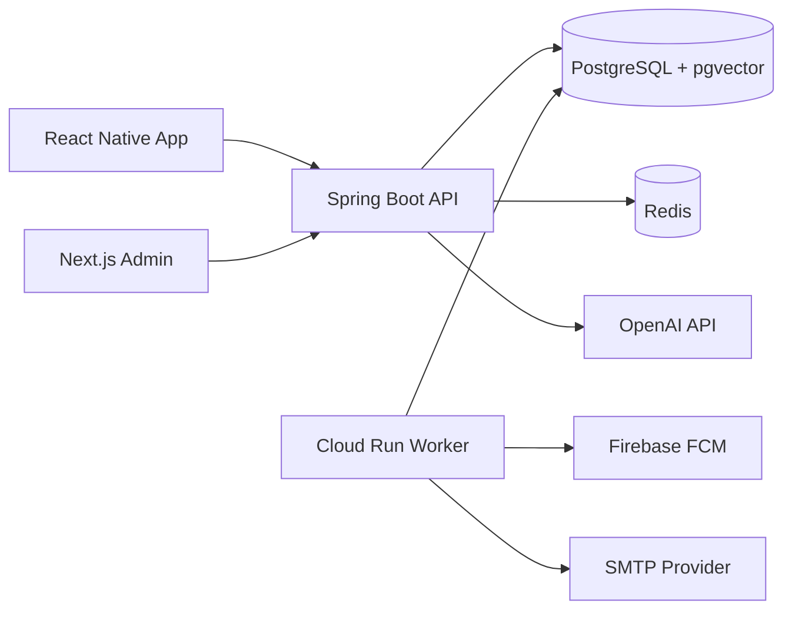

# My Pasture Backend

성경 읽기, 성경 근거 기반 AI 목자, 오늘의 말씀과 QR 기반 QT 모임을 제공하는 My Pasture의 Kotlin/Spring Boot 백엔드입니다.

> 현재 상태: MVP 기능 구현, GCP staging 배포 자동화 구성. 운영 트래픽과 장애 복구 훈련은 별도 검증이 필요합니다.

## Related Repositories

- Mobile: [mypasture-app](https://github.com/ByeongDoo-Han/mypasture-app)
- Admin: [mypasture-admin](https://github.com/ByeongDoo-Han/mypasture-admin)
- Landing: [mypasture.app](https://mypasture.app)

## What This Service Does

My Pasture는 일반 성도가 성경을 중심으로 읽기, 묵상, AI 상담과 현장 소그룹 QT를 이어갈 수 있도록 돕습니다.

- 1910 한국어 성경 66권의 장·절 조회, 단어 검색, 읽기 진행률, 북마크와 말씀 메모
- pgvector RAG와 인용 검증을 사용하는 AI 목자 JSON/SSE API
- 생성, 관리자 검수, 게시와 전달 이력을 갖는 오늘의 말씀
- 고정 목장 및 일회성 QT 모임, QR·짧은 코드 참여와 실시간 답변 공유
- 이메일·Google·Apple·Kakao 인증, JWT 회전과 회원탈퇴
- FCM 알림, 인앱 알림센터, 이메일 Outbox와 재시도
- AI 사용량·비용, 콘텐츠와 전달 상태를 관리하는 운영 API

## Architecture

백엔드는 도메인 우선 Clean Architecture를 사용합니다.

```text
com.example.mypasture
├── ai
│   ├── presentation
│   ├── application
│   ├── domain
│   └── infrastructure
├── auth
├── bible
├── daily_word
├── notification
├── quiet_time
└── user
```

의존 방향은 `presentation -> application -> domain`이며 Infrastructure가 Application Port를 구현합니다.



GCP에서는 같은 컨테이너 이미지를 API, Worker, Migration, Embedding Backfill 역할로 분리해 실행합니다.

## Technical Highlights

### Grounded AI

AI 요청은 질문 검증, 일일 사용량 선점, Redis 캐시, pgvector 검색, 성경 원문 재검증, OpenAI 생성, 인용 후검증, 사용량 기록 순서로 처리됩니다. 검색 결과에 없는 구절을 모델이 인용하면 응답 전에 차단합니다.

스트리밍 중 연결이 끊겨도 동일한 `clientRequestId`로 결과를 복구하며 같은 요청이 중복 과금·차감되지 않도록 영속 receipt와 상태를 관리합니다.

### Real-time Quiet Time

QT 답변은 PostgreSQL을 기준 데이터로 저장하고 Redis Pub/Sub과 SSE로 여러 API 인스턴스에 전달합니다. 연결 재시도 시 REST snapshot으로 최신 상태를 복원합니다.

### Durable Background Work

오늘의 말씀 생성, FCM과 이메일 발송은 사용자 요청과 분리합니다. Outbox, lease, fencing token, 유일 제약과 지수 backoff를 사용해 중복 실행과 장애 복구를 처리합니다.

### Security

- Access/refresh JWT 회전, token family 재사용 탐지와 security version 폐기
- Google·Apple nonce challenge, Kakao app ID·토큰 만료 서버 검증
- Redis Lua 기반 인증·AI rate limit과 정확한 CORS allowlist
- 사용자·모델·prompt version을 포함한 HMAC AI cache key
- Secret Manager 주입과 OpenAI `store: false`
- JPA/JdbcTemplate bind parameter 및 DTO 길이 검증

## Tech Stack

- Kotlin 2.0, Java 17, Spring Boot 3.4
- Spring Security, OAuth2/JWT, JPA, QueryDSL, Coroutines
- PostgreSQL 17, pgvector, Redis 7
- Flyway, OpenAI Responses API, Firebase Admin SDK
- Docker, Terraform, GitHub Actions OIDC, GCP Cloud Run·Cloud SQL·Compute Engine

## Local Development

### Requirements

- JDK 17
- Docker Desktop with Compose

### Configuration

```bash
cp .env.local.example .env.local
```

기본값은 로컬 테스트용입니다. 실제 API key, OAuth secret, Firebase service account와 운영 비밀번호는 커밋하지 않습니다.

### Run with PostgreSQL and Redis

```bash
docker compose up --build
```

- Backend: `http://localhost:8080`
- Health: `http://localhost:8080/actuator/health`
- PostgreSQL: `127.0.0.1:5432`
- Redis: `127.0.0.1:6379`

PostgreSQL 또는 Redis 포트가 이미 사용 중이면 `.env.local`에서 `POSTGRES_PORT`, `REDIS_PORT`를 변경합니다.

### Run with Local H2

```bash
./gradlew bootRun --args='--spring.profiles.active=local'
```

외부 과금을 막기 위해 로컬 기본값은 `AI_MOCK_ENABLED=true`, `FIREBASE_ENABLED=false`입니다.

## Test

```bash
./gradlew test --no-daemon
docker build --tag mypasture-backend:local .
```

실제 OpenAI 연결을 최소 토큰으로 확인하는 테스트는 명시적으로만 실행합니다.

```bash
OPENAI_API_KEY=<key> ./gradlew openAiSmokeTest
```

## Database and Bible Data

Flyway가 schema 변경 이력을 관리합니다. 적용된 migration 파일은 수정하지 않고 새 migration을 추가합니다.

기본 본문은 저작권 보호기간이 만료된 1910 한국어 성경을 사용합니다. 다른 번역본을 추가할 때는 별도의 이용 허락과 배포 조건을 확인해야 합니다.

## Deployment

`main` CI가 성공하면 staging 배포가 실행됩니다. GitHub Actions는 OIDC로 GCP 단기 자격증명을 발급받고 Migration, Worker, API 순서로 검증된 이미지 digest를 배포합니다. Production 배포는 `workflow_dispatch`로 수동 실행하며 승인 규칙은 GitHub의 production Environment 설정에서 관리합니다.

Terraform 구성은 다음을 관리합니다.

- Cloud Run API, Worker, Migration, Embedding Backfill
- private IP Cloud SQL PostgreSQL/pgvector
- TLS와 인증을 사용하는 private Redis VM
- Secret Manager, VPC, HTTPS Load Balancer와 모니터링

## Documentation

- [Architecture index](docs/architecture/README.md)
- [API specification](docs/api-spec.md)
- [Domain implementation checklist](docs/domain-checklist.md)
- [Security hardening](docs/security-hardening.ko.md)
- [AI RAG operations](docs/ai-rag-operations.ko.md)
- [GCP Terraform deployment](docs/gcp-terraform-deployment.ko.md)
- API 명세: 관리자 웹에 로그인한 뒤 **API 문서** 메뉴에서 조회합니다. 서버의 `/swagger-ui/**`와 `/v3/api-docs/**`는 활성 `ADMIN` JWT만 허용합니다. 직접 요청할 때는 `Authorization: Bearer <관리자 access token>` 헤더가 필요합니다. 관리자 웹의 문서 화면은 조회 전용입니다.
- [QT QR policy](docs/quiet-time-qr-policy.ko.md)
- [Today word operations](docs/daily-word-publishing-operations.ko.md)

문서의 `구현`, `부분 구현`, `계획` 표기를 코드 완료 상태와 구분해서 확인합니다.

## Contribution Workflow

1. GitHub Issue를 작성합니다.
2. 최신 `main`에서 `feat/<domain>-<issue>-<description>` 브랜치를 만듭니다.
3. 테스트와 CI가 성공한 뒤 `main` 대상 PR을 생성합니다.
4. 배포 영향과 migration 호환성을 확인한 뒤 merge합니다.
