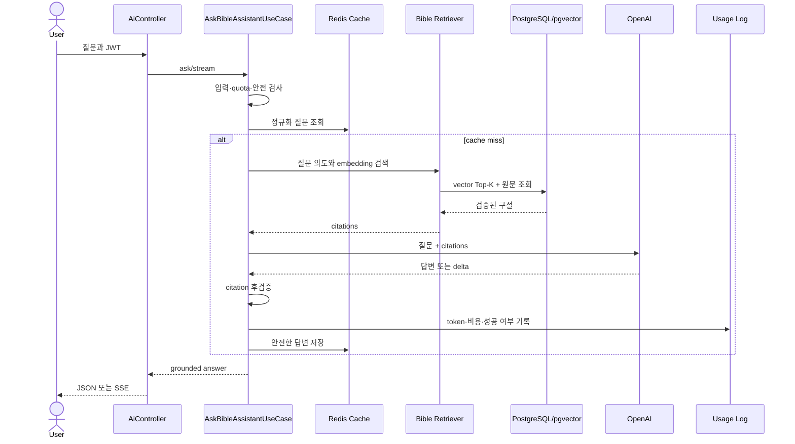
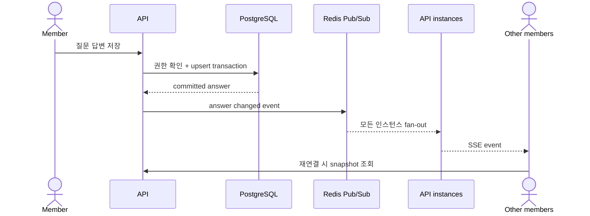

# My Pasture Backend Architecture (arc42)

작성 기준일: 2026-08-29
대상: `mypasture-backend`
상태: Living document

## 1. 소개와 목표

My Pasture는 성경 읽기를 중심으로 AI 목자, 오늘의 말씀, QT 모임, 출석과 알림을 제공하는 서비스입니다.
백엔드는 다음 목표를 우선합니다.

1. 존재하지 않는 성경 구절을 AI가 근거로 제시하지 않도록 서버 RAG와 인용 검증을 강제합니다.
2. 일반 성경 읽기는 공개 API로 제공하고, 개인화 기능은 인증된 사용자에게 제공합니다.
3. API 요청 처리와 예약·외부 발송 작업을 분리해 사용자 요청의 지연과 장애 전파를 줄입니다.
4. 수만 명 규모에서 수평 확장할 수 있도록 상태를 PostgreSQL과 Redis에 외부화합니다.
5. 운영 변경은 Terraform과 검증된 불변 컨테이너 이미지로 재현할 수 있어야 합니다.

주요 이해관계자는 일반 성도, 목장 리더, 운영 관리자, 개발·운영 담당자입니다.

## 2. 제약사항

| 구분 | 제약 |
| --- | --- |
| 기술 | Kotlin, Spring Boot 3, Spring Security, JPA/QueryDSL, Flyway |
| 데이터 | PostgreSQL이 영속 데이터의 기준이며 벡터 검색은 pgvector 사용 |
| 캐시·실시간 | Redis는 캐시, rate limit, Pub/Sub 용도이며 영속 기준 데이터로 사용하지 않음 |
| AI | 입력 최대 300자, RAG 선행, 출력 제한, 토큰·비용 기록, timeout/retry 적용 |
| 인증 | Stateless JWT, Google·Apple·Kakao 토큰 서버 검증 |
| 배포 | GCP, Docker, Terraform, GitHub Actions OIDC, `linux/amd64` 이미지 |
| 데이터 변경 | 기존 Flyway 파일은 수정하지 않고 새 migration만 추가 |
| 저장소 | 도메인 우선 패키지 아래 Presentation/Application/Domain/Infrastructure 유지 |

모바일과 관리자 애플리케이션은 별도 저장소이므로 이 문서에서는 외부 클라이언트로 취급합니다.

## 3. 시스템 범위와 컨텍스트

현재 시스템과 사용자·외부 공급자의 경계는 [C4 System Context](c4/01-system-context.md)에 정의합니다.

- 입력: 모바일·웹·관리자 HTTPS 요청, OAuth ID token, 기기 FCM token
- 출력: REST/SSE 응답, OpenAI 요청, FCM push, SMTP email
- 운영 입력: GitHub Actions OIDC 배포, 관리자용 운영 API
- 계획 경계: Cloudflare R2 파일 저장은 요구사항에 있으나 현재 백엔드 기준 경로에는 구현되지 않았습니다.

## 4. 해결 전략

| 품질 목표 | 전략 |
| --- | --- |
| AI 신뢰성 | 질문 의도 분석 → pgvector 검색 → 원문 재검증 → 답변 생성 → citation 검증 |
| 보안 | JWT 필터, 역할 기반 접근 제어, CORS allowlist, Redis 원자 rate limit |
| 가용성 | Stateless API, 별도 Worker, Cloud Run 자동 확장, 외부 상태 저장 |
| 데이터 일관성 | PostgreSQL transaction, unique constraint, Flyway, outbox 기반 전달 |
| 비용 통제 | RAG Top-K, Redis cache, 일일 quota, token/cost 기록, 별도 유료 backfill job |
| 배포 안정성 | CI 성공 후 staging 자동배포, migration 선행, digest 배포, 이미지 rollback |

## 5. 빌딩 블록 관점

실행 단위와 저장소 관계는 [C4 Container](c4/02-containers.md)를 기준으로 합니다.

백엔드 도메인은 다음과 같이 나뉩니다.

| 도메인 | 주요 책임 | 상태 |
| --- | --- | --- |
| `auth`, `user` | 이메일·소셜 인증, JWT, 계정 정책 | 구현 |
| `bible`, `reading` | 성경 원문, 검색, 북마크, 해설, 읽기 기록 | 구현 |
| `ai` | 질문 이해, RAG, 답변 생성·평가, 비용 기록 | 구현 |
| `daily_word` | 오늘의 말씀 생성·게시·장애 운영 | 구현 |
| `quiet_time` | 고정·일회성 QT, QR 참여, 답변과 SSE | 구현 |
| `notification` | 기기 등록, 알림함, FCM 전달 lifecycle | 구현 |
| `attendance`, `faith_profile` | 출석, 신앙 성향 평가 | 부분 구현 |
| 목장·기도·챌린지·리워드 | 장기 커뮤니티와 수집 요소 | 계획 |

레이어 의존 방향은 `presentation -> application -> domain`이며 infrastructure가 application port를 구현합니다.
AI 도메인의 상세 구조는 [C4 AI Component](c4/03-ai-components.md)를 참고합니다.

## 6. 런타임 관점

### AI 목자 RAG

검색 구절이 없거나 생성 답변의 인용이 검색 결과와 일치하지 않으면 안전하게 실패합니다.

### QT 답변 실시간 공유

Redis 이벤트는 알림 수단이며 최종 답변은 PostgreSQL snapshot으로 복구합니다.

### 배포

배포 런타임은 [C4 Deployment](c4/04-deployment.md)에 정의합니다. Migration Job이 성공하기 전에는 Worker와 API 이미지를 변경하지 않습니다.

## 7. 배포 관점

- API: 외부 REST/SSE 요청을 처리하는 Cloud Run Service
- Worker: 예약 생성, outbox·FCM·email, 해설 작업을 처리하는 Cloud Run Service
- Migration: Flyway와 성경 원문 적재를 실행하는 Cloud Run Job
- Embedding Backfill: 비용이 발생하는 임베딩 적재 전용 Cloud Run Job
- PostgreSQL: private IP Cloud SQL + pgvector
- Redis: TLS·인증을 사용하는 별도 Compute Engine VM 또는 환경별 Memorystore 선택지
- Secret Manager: JWT, DB, OAuth, OpenAI, SMTP, Firebase secret 전달

Nginx는 로컬·단일 VM Docker Compose 경로에서 사용할 수 있지만 GCP Cloud Run의 기준 진입점은 아닙니다.

## 8. 횡단 관심사

### 인증과 권한

- Access/refresh JWT를 서버에서 검증하고 security version으로 강제 만료할 수 있습니다.
- 공개 성경·health·인증 시작 API 외에는 기본적으로 인증이 필요합니다.
- `/api/v1/admin/**`는 `ADMIN` 역할을 요구합니다.
- OAuth provider token은 클라이언트 값을 신뢰하지 않고 공급자 검증 결과를 사용합니다.

### 오류와 관찰성

- 공통 오류 envelope와 도메인 exception handler를 사용합니다.
- `X-Trace-Id`로 요청 상관관계를 추적합니다.
- AI usage, 알림 전달 상태와 오늘의 말씀 incident를 영속화합니다.

### 비동기 처리와 일관성

- DB commit과 외부 FCM·email 발송을 같은 transaction으로 간주하지 않습니다.
- outbox 상태, 재시도, lease와 idempotency를 이용해 적어도 한 번 처리에 대응합니다.
- coroutine은 외부 I/O 대기와 SSE에 사용하지만 durable queue를 대체하지 않습니다.

### 설정과 비밀

- `application.yml`은 구조와 안전한 기본값만 제공하고 운영 비밀은 Secret Manager에서 주입합니다.
- local/prod profile과 API/Worker/Job runtime role을 분리합니다.

## 9. 아키텍처 결정

채택된 결정은 [ADR 인덱스](adr/README.md)에서 관리합니다. ADR은 결정의 배경과 대안, 긍정·부정 결과를 포함합니다.

## 10. 품질 요구사항

| ID | 품질 시나리오 | 검증 기준 |
| --- | --- | --- |
| Q-01 | AI가 존재하지 않는 구절을 제시하려 함 | 검색되지 않은 citation은 응답 전에 차단 |
| Q-02 | `main`에 검증된 변경이 병합됨 | CI 성공 이벤트만 staging 자동배포 시작 |
| Q-03 | 새 API 이미지의 readiness 실패 | 이전 API·Worker·Job 이미지로 복구 시도 |
| Q-04 | 같은 알림 작업이 재실행됨 | 영속 상태와 idempotency로 중복 영향을 제한 |
| Q-05 | API 인스턴스가 여러 개로 증가함 | JWT, DB, Redis 외 로컬 사용자 상태 없이 동작 |
| Q-06 | Redis Pub/Sub 연결이 끊김 | REST snapshot으로 QT 답변 상태 복구 |
| Q-07 | 무료 사용자가 AI 한도를 초과함 | OpenAI 호출 전에 요청 거부 |

필수 검증은 `./gradlew test`, Terraform `fmt/validate`, 컨테이너 빌드와 배포 후 readiness·성경 66권 smoke test입니다.

## 11. 위험과 기술 부채

| 위험 | 영향 | 현재 대응 / 다음 조치 |
| --- | --- | --- |
| Redis 단일 VM 장애 | cache, rate limit, 실시간 fan-out 저하 | 영속 데이터는 PostgreSQL 유지 / failover·복구 훈련 필요 |
| OpenAI·OAuth·FCM 공급자 장애 | AI·로그인·push 일부 중단 | timeout/retry와 분리된 worker / 장애 시 UX 검증 필요 |
| pgvector 데이터 증가 | 검색 지연과 DB 부하 | HNSW와 Top-K / 실제 규모 부하 테스트 필요 |
| 장시간 SSE 연결 증가 | Cloud Run connection·memory 압력 | bounded executor / 동시 연결 부하 테스트 필요 |
| migration의 비가역성 | 이미지 rollback만으로 DB 복구 불가 | expand/contract migration과 백업 복구 훈련 필요 |
| 문서와 코드 불일치 | 잘못된 운영 판단 | PR checklist에서 architecture 영향 검토 필요 |
| R2 미구현 | 말씀 카드·프로필 파일 저장 부재 | object storage 도입 ADR과 보안 정책 필요 |
| 운영 환경 검증 범위 | staging과 prod 차이 | prod Terraform plan, 승인, 복구 훈련 별도 수행 |

## 12. 용어집

| 용어 | 의미 |
| --- | --- |
| RAG | 검색한 성경 구절을 근거로 생성 모델이 답변하는 방식 |
| Citation | AI 답변의 근거가 되는 실제 성경 장·절 |
| Outbox | DB transaction에서 외부 전달 작업을 영속적으로 기록하는 패턴 |
| SSE | 서버가 클라이언트로 이벤트를 지속 전송하는 HTTP 방식 |
| WIF | GitHub OIDC를 GCP 단기 자격증명으로 교환하는 Workload Identity Federation |
| Immutable image | 커밋 SHA와 digest로 식별되어 내용이 바뀌지 않는 컨테이너 이미지 |
| Runtime role | 같은 이미지에서 API, Worker, Migration, Backfill 역할을 설정으로 분리한 실행 모드 |
