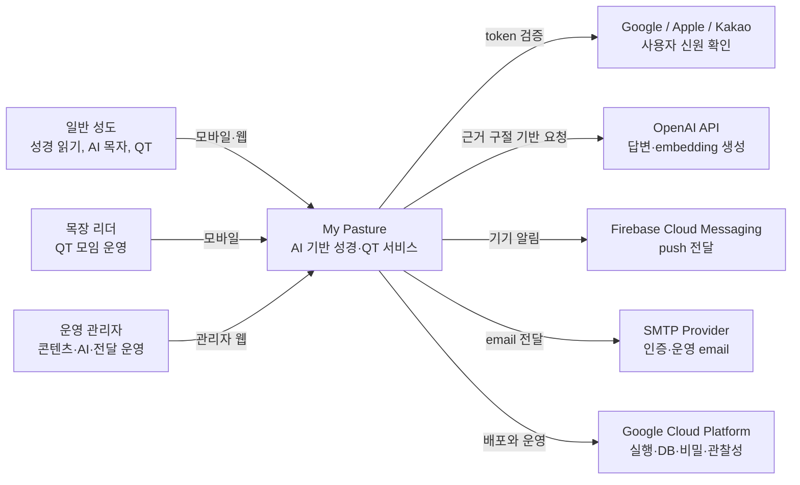

# C4 Level 1: System Context

My Pasture 시스템의 사용자와 외부 시스템 경계를 표현합니다. 모바일과 관리자는 별도 배포 단위이지만 하나의 서비스 경험을 구성합니다.

## 경계 설명

- My Pasture는 OAuth 공급자가 발급한 token을 검증하지만 공급자의 계정·동의 화면은 소유하지 않습니다.
- OpenAI는 답변을 생성하지만 성경 원문과 최종 citation 허용 여부는 My Pasture 서버가 통제합니다.
- FCM의 요청 수락은 실제 기기 수신을 보장하지 않으므로 전달 lifecycle을 별도로 기록합니다.
- Cloudflare R2는 제품 요구사항에는 있으나 현재 백엔드 구현 경계에는 포함하지 않습니다.

[아키텍처 인덱스로 돌아가기](../README.md)
