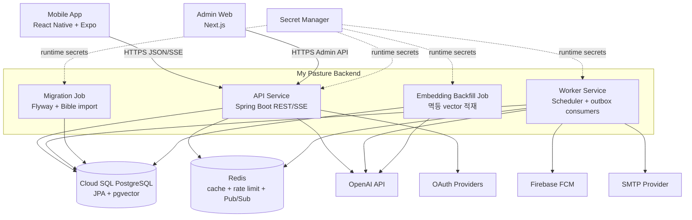

# C4 Level 2: Containers

여기서 Container는 Docker만이 아니라 독립적으로 실행·배포되거나 데이터를 보유하는 단위를 의미합니다.

## 책임과 확장 단위

| Container | 책임 | 상태·확장 전략 |
| --- | --- | --- |
| Mobile App | 공개 성경, 로그인, 개인화, QT, AI UX | 별도 저장소와 앱 배포 |
| Admin Web | 콘텐츠·AI 모델·운영 상태 관리 | 별도 저장소와 웹 배포 |
| API Service | 인증, REST/SSE, transaction 시작 | Stateless, Cloud Run 수평 확장 |
| Worker Service | 예약·outbox·외부 발송·생성 작업 | API와 독립적으로 scale 조절 |
| Migration Job | schema migration과 성경 원문 적재 | 배포 전에 1회 실행 |
| Embedding Job | 성경 embedding 비용 작업 | 사람의 승인으로만 실행 |
| PostgreSQL | 영속 데이터와 vector 검색의 기준 | private IP, backup·PITR 필요 |
| Redis | 휘발성 cache, 제한, fan-out | 유실 후 DB에서 복구 가능해야 함 |

[아키텍처 인덱스로 돌아가기](../README.md)
