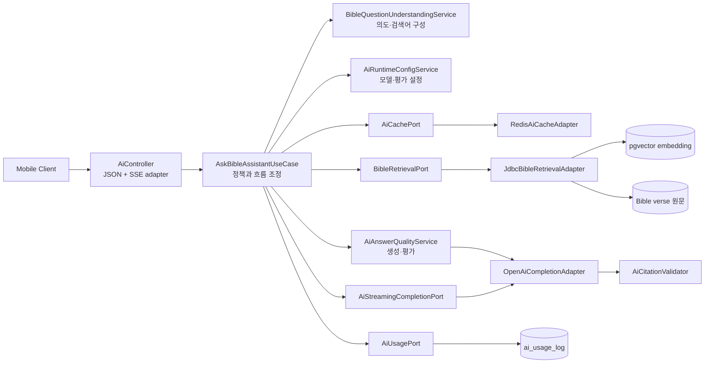

# C4 Level 3: AI Components

API Service 안에서 AI 목자 요청을 처리하는 주요 컴포넌트입니다.

## 불변 정책

1. 입력 길이와 사용자 quota는 OpenAI 호출 전에 검사합니다.
2. 질문 의도를 이해한 뒤 embedding/lexical 검색으로 후보를 찾습니다.
3. 후보 ID를 실제 성경 원문과 다시 대조합니다.
4. 생성 모델에는 선택된 구절만 전달합니다.
5. 생성 결과의 장·절이 허용 citation 집합 밖이면 응답하지 않습니다.
6. 성공·실패와 token·예상 비용을 기록합니다.
7. streaming도 동일한 정책 경계를 우회할 수 없습니다.

## 의존 방향

Application 컴포넌트는 Redis, JDBC, OpenAI SDK에 직접 의존하지 않고 port를 사용합니다. Infrastructure adapter 교체가 정책 흐름을 바꾸지 않도록 하기 위한 구조입니다.

[아키텍처 인덱스로 돌아가기](../README.md)
