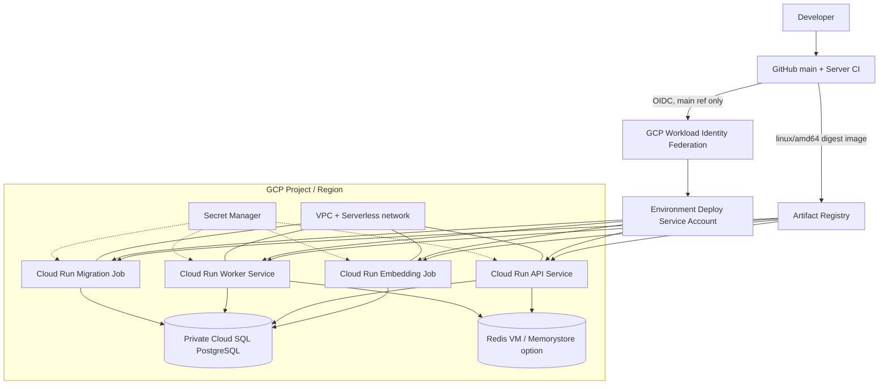
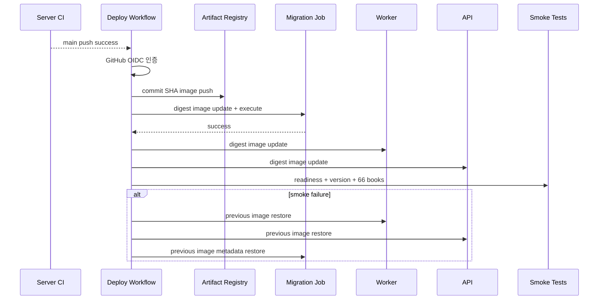

# C4 Deployment View

GCP staging/prod의 기준 배포 구조와 GitHub Actions 전달 경로입니다.

## 자동배포 순서

Staging은 `main` CI 성공 후 자동배포합니다. Production은 `main`에서 수동 실행하고 GitHub Environment 승인 정책을 적용합니다. 이미지 rollback은 DB schema를 되돌리지 않으므로 migration은 expand/contract 방식이어야 합니다.

[GCP Terraform 상세 가이드](../../gcp-terraform-deployment.ko.md)
[아키텍처 인덱스로 돌아가기](../README.md)
