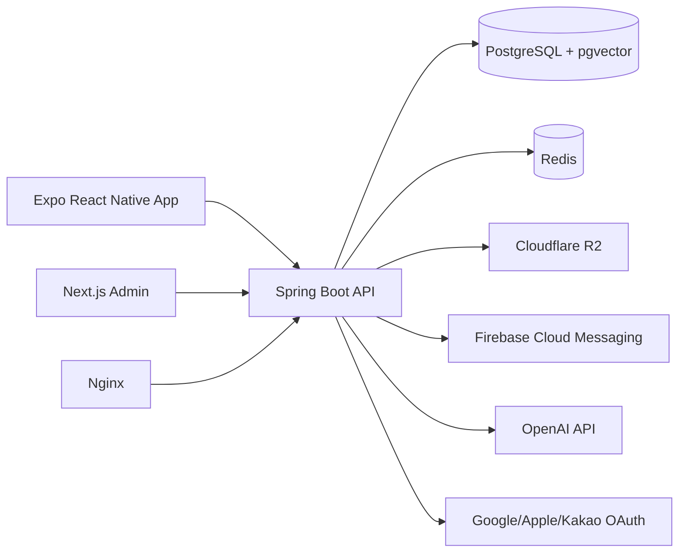
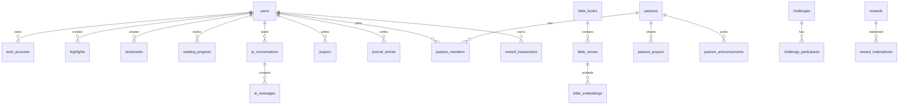
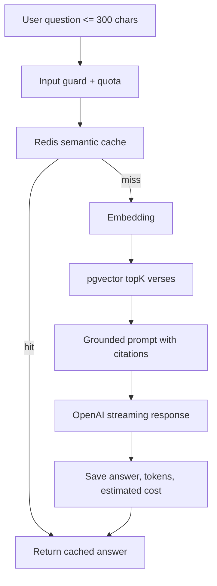
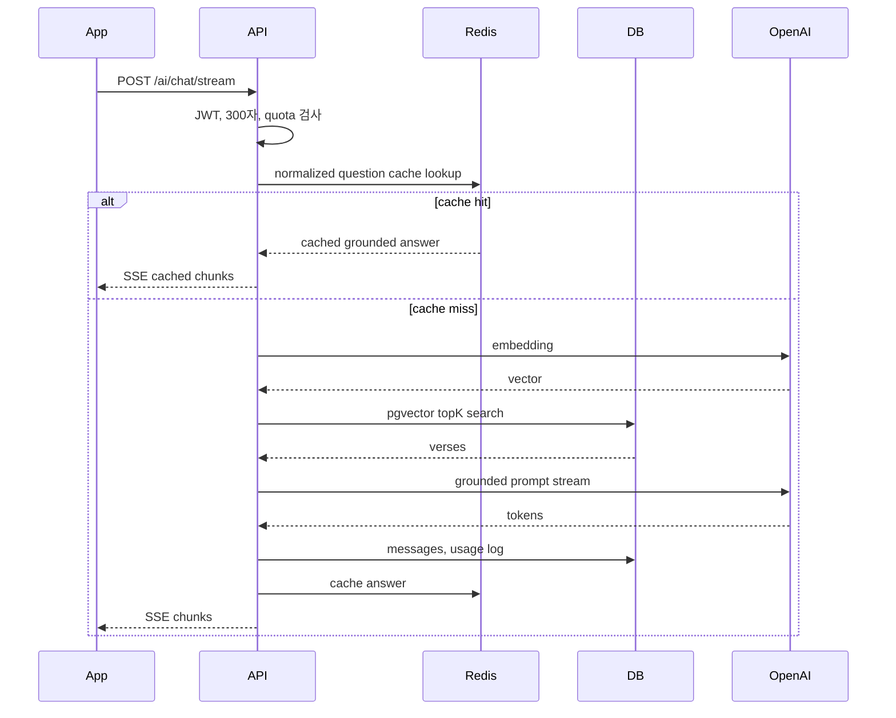
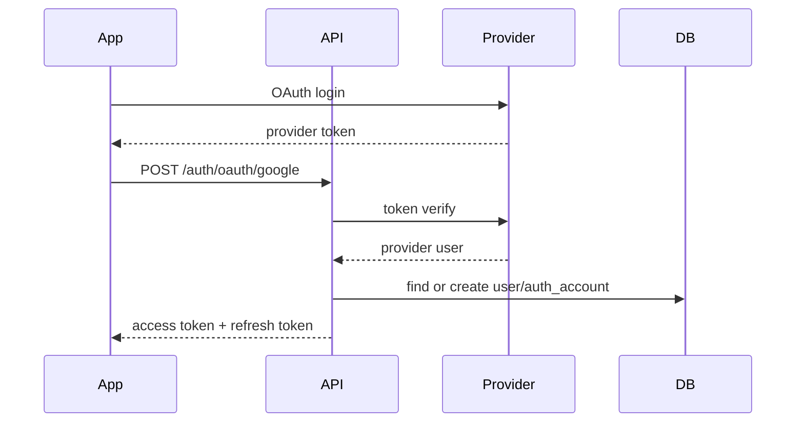

# My Pasture Production Design

작성 기준일: 2026-08-01  
목표: 수만~수십만 명의 사용자를 안정적으로 지원하는 AI 기반 성경 앱

## 1. 전체 시스템 아키텍처



### 선택 이유

- React Native + Expo: 빠른 배포, OTA 업데이트, iOS/Android 공통 코드. 단점은 일부 네이티브 기능 최적화 시 config plugin 또는 bare workflow가 필요합니다.
- Kotlin + Spring Boot 3: 타입 안전성, 대규모 백엔드 생태계, Spring Security/JPA/Flyway/OpenAPI 통합. 단점은 초기 설정과 빌드 시간이 Node 계열보다 무겁습니다.
- PostgreSQL + pgvector: 트랜잭션 데이터와 성경 임베딩 검색을 한 DB에서 처리. 단점은 초대규모 벡터 검색은 전용 벡터 DB 대비 튜닝이 필요합니다.
- Redis: AI 응답 캐시, rate limit, 세션성 데이터, 분산락. 단점은 영속 데이터의 source of truth로 쓰면 운영 리스크가 큽니다.
- Cloudflare R2: 말씀 카드/프로필 이미지 저장, S3 호환 API, egress 비용 장점. 단점은 AWS IAM과 다른 운영 모델을 익혀야 합니다.
- GCP + Docker + Nginx: 표준적인 컨테이너 배포와 로드밸런싱. 트래픽 증가 시 Cloud Run/GKE로 확장 가능합니다.

### Clean Architecture

- Presentation: REST Controller, DTO, Security Filter
- Application: UseCase, Command/Query Service, Transaction Boundary
- Domain: Entity Aggregate, Domain Service, Repository Port
- Infrastructure: JPA Adapter, OpenAI Client, Redis Cache, R2, FCM

## 2. ERD



## 3. DB 설계

핵심 원칙:

- 모든 테이블은 `id uuid`, `created_at`, `updated_at` 기본 컬럼을 둡니다.
- 개인정보/인증/AI 로그는 접근 권한과 보존 기간을 분리합니다.
- 성경 본문은 정적 레퍼런스 데이터로 버전 관리합니다.
- RAG는 `bible_embeddings.embedding vector(1536)` 기준으로 시작하고, 모델 변경 시 `embedding_model`과 `dimensions`로 이중 운영합니다.

주요 인덱스:

- `users(email) unique where deleted_at is null`
- `auth_accounts(provider, provider_user_id) unique`
- `bible_verses(version, book_id, chapter, verse)`
- `bible_embeddings using hnsw (embedding vector_cosine_ops)`
- `ai_usage_logs(user_id, created_at)`
- `reading_progress(user_id, bible_version, book_id, chapter)`
- `notifications(user_id, read_at, created_at)`

## 4. JPA Entity

초기 구현은 `apps/backend`에 다음 핵심 엔티티를 포함합니다.

- `UserEntity`: 사용자, 권한, 구독 등급, AI 일일 사용량 판단의 기준
- `AuthAccountEntity`: Google/Apple/Kakao/Email 계정 연결
- `BibleBookEntity`, `BibleVerseEntity`, `BibleEmbeddingEntity`: 성경 텍스트와 벡터 검색
- `AiConversationEntity`, `AiMessageEntity`, `AiUsageLogEntity`: AI 대화와 비용 추적
- `HighlightEntity`, `BookmarkEntity`, `ReadingProgressEntity`: 읽기 경험
- `PrayerEntity`, `JournalEntryEntity`: 기도와 성경일기
- `PastureEntity`, `PastureMemberEntity`: 목장
- `ChallengeEntity`, `ChallengeParticipantEntity`: 챌린지

## 5. REST API 명세

Swagger 경로: `/swagger-ui/index.html`, OpenAPI JSON: `/v3/api-docs`

### Auth

- `POST /api/v1/auth/email/signup`
- `POST /api/v1/auth/email/login`
- `POST /api/v1/auth/oauth/{provider}`
- `POST /api/v1/auth/token/refresh`
- `POST /api/v1/auth/logout`

### Bible

- `GET /api/v1/bible/books`
- `GET /api/v1/bible/{version}/{book}/{chapter}`
- `GET /api/v1/bible/search?q=&version=&page=`
- `POST /api/v1/bible/highlights`
- `POST /api/v1/bible/bookmarks`
- `PUT /api/v1/bible/progress`
- `GET /api/v1/bible/offline-packages/{version}`

### AI

- `POST /api/v1/ai/chat`
- `POST /api/v1/ai/chat/stream` with `text/event-stream`
- `POST /api/v1/ai/bible-explain`
- `GET /api/v1/ai/conversations`
- `GET /api/v1/ai/usage/me`

제약:

- 사용자 입력 최대 300자
- 무료 회원 하루 10회
- 출력 토큰 기본 700 이하
- 모든 응답은 RAG 검색 구절 citation 포함

### Daily

- `GET /api/v1/daily-word/today`
- `PUT /api/v1/notification-settings/daily-word`

### Pasture

- `POST /api/v1/pastures`
- `POST /api/v1/pastures/{id}/invites`
- `POST /api/v1/pastures/{id}/join`
- `GET /api/v1/pastures/{id}/dashboard`
- `POST /api/v1/pastures/{id}/prayers`
- `POST /api/v1/pastures/{id}/announcements`
- `POST /api/v1/pastures/{id}/attendance`

### Admin

- `GET /api/v1/admin/users`
- `POST /api/v1/admin/daily-word`
- `POST /api/v1/admin/challenges`
- `POST /api/v1/admin/rewards`
- `POST /api/v1/admin/push-campaigns`
- `GET /api/v1/admin/ai-usage`
- `GET /api/v1/admin/statistics`

## 6. 폴더 구조

```text
apps/
  backend/
    src/main/kotlin/com/mypasture/
      presentation/
      application/
      domain/
      infrastructure/
      config/
  mobile/
    src/app/
    src/features/
    src/shared/
  admin/
    src/app/
    src/features/
infra/
  nginx/
docs/
```

## 7. 인증 구조

- OAuth2: Google, Apple, Kakao는 provider token 검증 후 내부 사용자와 연결합니다.
- Email: Argon2 또는 BCrypt password hash. 이메일 인증은 별도 토큰 테이블로 확장합니다.
- JWT: access token 15분, refresh token 30일. refresh token은 해시 후 DB/Redis에 저장하고 rotation합니다.
- 권한: `USER`, `PREMIUM`, `PASTURE_LEADER`, `ADMIN`.
- 모바일 보관: Expo SecureStore에 refresh token, 메모리/상태에는 access token만 둡니다.

장점: stateless access token으로 API 확장성이 높습니다.  
단점: 토큰 폐기/탈취 대응을 위해 refresh rotation과 device session 관리가 필요합니다.

## 8. AI 구조



핵심 정책:

- 성경 전체를 prompt에 넣지 않습니다.
- `topK=8~12` 구절만 RAG context로 전달합니다.
- 답변은 반드시 검색된 구절 ID와 본문에 근거해야 합니다.
- 근거 부족 시 “관련 구절을 충분히 찾지 못했습니다”로 답합니다.
- 존재하지 않는 구절 생성 금지. 구절 표기는 DB의 `book/chapter/verse`만 사용합니다.
- 동일/유사 질문은 Redis 캐시. 운영 초기에는 정규화 텍스트 hash 캐시, 이후 embedding 기반 semantic cache를 추가합니다.
- 오늘의 말씀/묵상은 하루 1회 batch 생성 후 DB 저장, 전체 사용자 공유.

OpenAI 비용 기준:

- 공식 OpenAI 자료 기준 GPT-5 mini는 standard API에서 입력 $0.25/1M, 출력 $2/1M tokens, GPT-5 nano는 입력 $0.05/1M, 출력 $0.40/1M tokens로 안내됩니다. `text-embedding-3-small`은 $0.00002/1K tokens, `text-embedding-3-large`는 $0.00013/1K tokens로 공개되어 있습니다.
- 실제 운영에서는 결제 계정의 모델/티어/지역별 단가를 주기적으로 확인해야 합니다.

## 9. 푸시 구조

- 앱에서 FCM token 등록: `POST /api/v1/notifications/devices`
- 알림 설정: local timezone, quiet hours, daily word times
- 예약: Spring Scheduler가 활성 설정을 페이지로 조회하고 기기별 delivery를 멱등 생성
- 발송: lease 기반 선점, 제한된 coroutine 병렬 처리, 일시 오류 backoff와 영구 token 비활성화
- 이벤트: 오늘의 말씀, 챌린지 리마인더, 목장 댓글/공지, 기도 응답, 출석 streak

## 10. 챌린지 구조

- Challenge: 일간/주간/월간/퀴즈 타입
- Rule: JSONB로 목표 타입, XP, 달란트, 기간, 반복 규칙 저장
- Participant: 진행률, 완료 여부, 보상 지급 여부
- Streak: 출석/읽기/기도 분리 계산
- 보상 정합성: reward transaction은 idempotency key로 중복 지급 방지

## 11. 시퀀스 다이어그램

### AI Chat



### OAuth Login



## 12. UI 와이어프레임

### Mobile Tabs

```text
┌─────────────────────────┐
│ 오늘                    │
│ 오늘의 말씀 / 묵상      │
│ 실천 질문 / 챌린지      │
├─────────────────────────┤
│ 읽기 │ AI │ 목장 │ 기도 │ 나 │
└─────────────────────────┘
```

### Bible Reader

```text
┌──────── 창세기 1장 ───────┐
│ 검색  북마크  글자크기    │
│ 1 태초에...              │
│ 2 땅이...                │
│ [하이라이트][AI 해설]     │
└──────────────────────────┘
```

### AI Assistant

```text
┌──── AI 성경 비서 ────────┐
│ "불안합니다"             │
│ 근거: 빌 4:6-7, 시 23:4  │
│ 답변 카드 + 기도문 생성   │
└──────────────────────────┘
```

### Admin Dashboard

```text
Users | Daily Word | Challenges | Rewards | Push | AI Usage | Stats
┌────────────┬────────────┬────────────┐
│ 가입자     │ AI 비용     │ 활성 목장   │
└────────────┴────────────┴────────────┘
```

## 13. 개발 로드맵

1. Phase 0: 설계, 법무/라이선스 검토, 성경 번역본 데이터 확보
2. Phase 1: Auth, Bible reader/search/offline, profile
3. Phase 2: RAG AI assistant, usage quota, AI logs, daily word
4. Phase 3: Prayer, journal, highlights/bookmarks, word card
5. Phase 4: Pasture, challenge, XP/talent/reward
6. Phase 5: Admin, push campaign, analytics
7. Phase 6: hardening, load test, security audit, observability

## 14. CI/CD

- PR: backend test, ktlint, mobile/admin typecheck, Docker build
- main: Docker image build/push, migration dry-run, deploy to staging
- release tag: production deploy with manual approval
- DB migration: Flyway forward-only, rollback은 새 migration으로 보정
- Secrets: GitHub Actions OIDC + GCP Secret Manager

## 15. 보안 체크리스트

- OAuth token server-side verification
- JWT short TTL + refresh rotation
- password hash BCrypt/Argon2
- API rate limit per user/IP
- AI prompt injection 방어: 성경 context와 system policy 분리
- 개인정보 암호화 대상 분류
- 관리자 MFA, IP allowlist 옵션
- R2 signed URL, public bucket 금지
- 로그에 token/password/기도제목 전문 저장 금지 또는 마스킹
- Flyway migration review
- dependency vulnerability scan
- mobile jailbreak/root 탐지와 certificate pinning은 고위험 단계에서 도입

## 16. 비용 예측

가정:

- MAU 100,000, DAU 20,000
- 무료 사용자의 AI 평균 3회/일, 프리미엄 20회/일
- AI 1회 평균 input 1,200 tokens, output 450 tokens, embedding 100 tokens
- 캐시 hit 25%
- 생성 모델: GPT-5 mini, embedding: text-embedding-3-small

월 AI 비용 예시:

- 비캐시 요청: 20,000 * 3 * 30 * 75% = 1,350,000 calls
- GPT input: 1,350,000 * 1,200 / 1M * $0.25 = 약 $405
- GPT output: 1,350,000 * 450 / 1M * $2 = 약 $1,215
- Embedding: 1,350,000 * 100 / 1K * $0.00002 = 약 $2.70
- 합계: 약 $1,623/월 + 오늘의 말씀 batch + 운영 여유

인프라 초기 월 비용 범위:

- API 2~4대, Postgres managed, Redis, object storage, egress, monitoring 포함 약 $800~$3,000/월
- 100K MAU 이후 read replica, Redis cluster, CDN 최적화에 따라 증가

## 17. 확장 전략

- API: stateless Spring Boot replicas, Nginx/LB, horizontal autoscaling
- DB: connection pool, read replica, partitioning for logs, pgvector HNSW tuning
- AI: Redis cache, daily batch, premium quota, queue-based async jobs
- Push: campaign은 queue로 분산 처리
- Media: R2 + CDN + signed URL
- Search: PostgreSQL FTS로 시작, 트래픽 증가 시 OpenSearch 고려
- Observability: Prometheus/Grafana, structured logs, tracing

## 18. 테스트 전략

- Unit: domain policy, quota, challenge reward, prompt builder
- Integration: Testcontainers PostgreSQL/Redis, Flyway migration, JPA repository
- Contract: OpenAPI snapshot, mobile/admin API client generation
- E2E: auth, bible reader, AI streaming, pasture invite
- Load: k6로 AI 제외 API와 AI mocked API 분리 측정
- Security: OWASP ZAP, dependency scan, JWT fuzzing
- Mobile: Detox smoke test, offline read cache test

## 19. 코딩 컨벤션

Backend:

- package는 architecture layer 기준
- UseCase는 동사형: `AskBibleAssistantUseCase`
- Domain은 framework annotation 최소화
- JPA Entity와 Domain Model 분리 가능하나 초기 속도를 위해 persistence model 우선, 복잡도가 커지면 mapper 분리
- Controller는 얇게 유지하고 validation은 DTO + Zod/OpenAPI 대응

Mobile/Admin:

- feature-first 구조
- API 호출은 TanStack Query hook으로 캡슐화
- 전역 auth/session만 Zustand
- form은 React Hook Form + Zod
- list는 FlashList
- NativeWind className은 디자인 토큰 기준

Git:

- Conventional Commits
- migration 파일은 수정 금지, 새 파일로 보정
- PR은 테스트 결과와 migration 영향 포함
