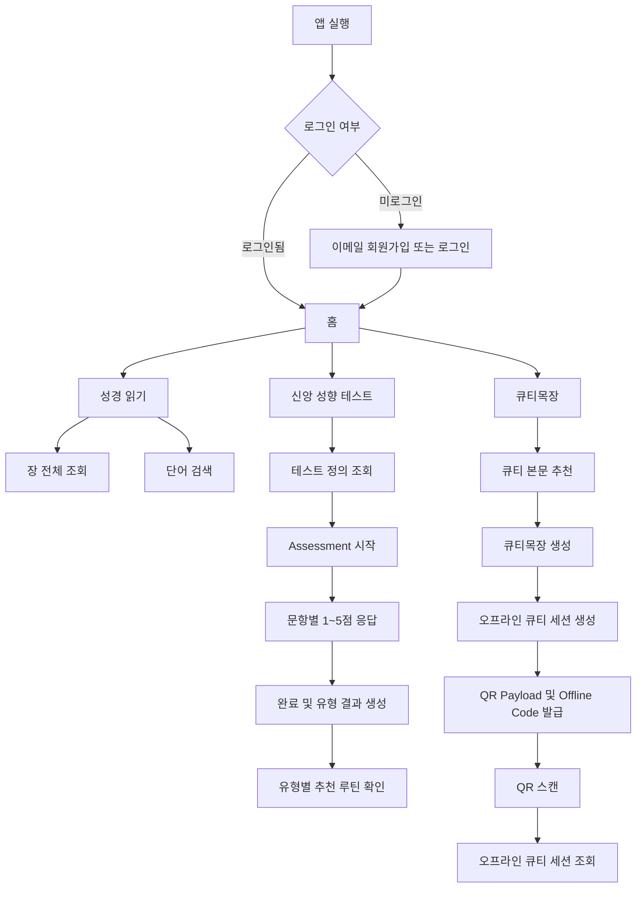
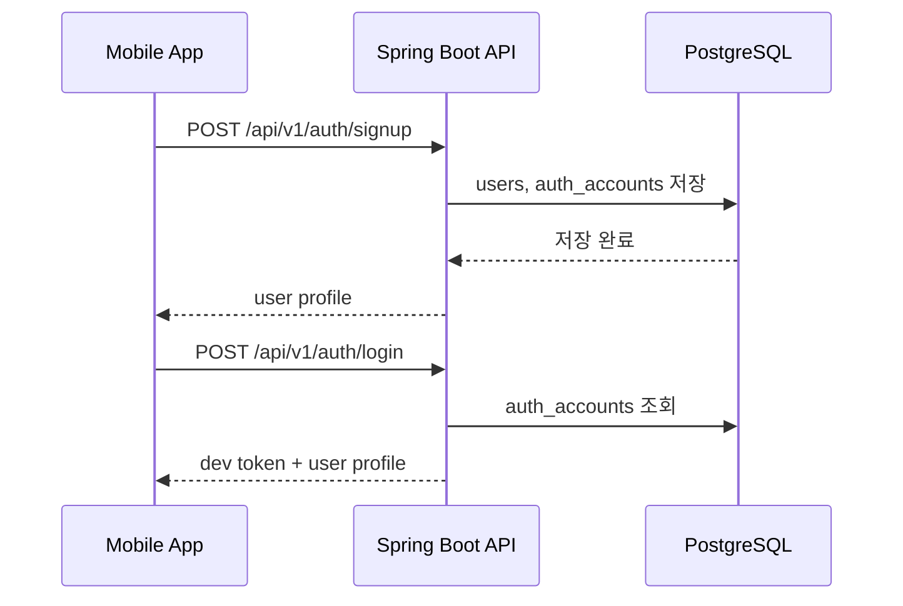
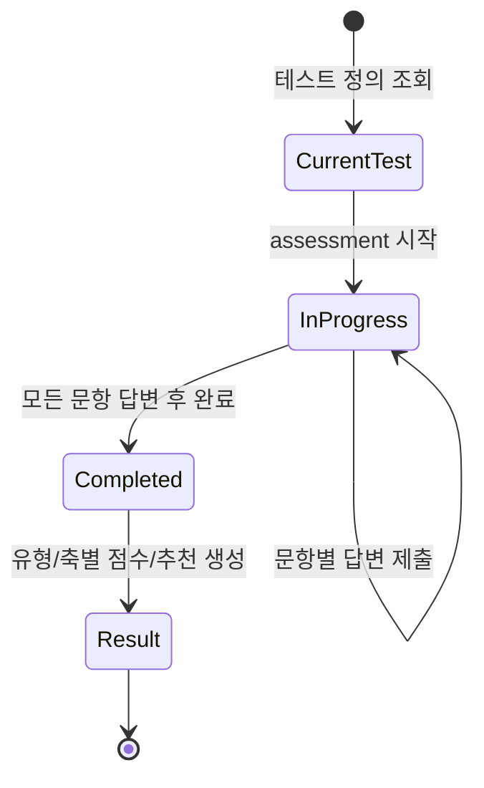
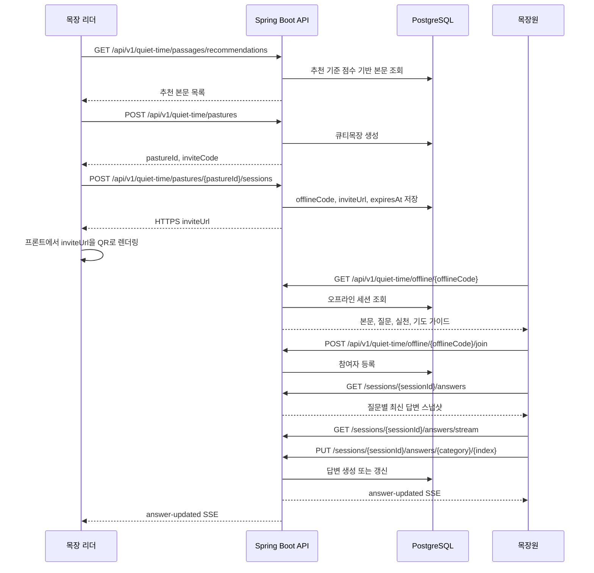

# My Pasture Service Flow

이 문서는 현재 구현된 My Pasture 백엔드 API를 기준으로 사용자가 앱에 들어와 말씀을 읽고, 신앙 성향을 확인하고, 큐티목장 오프라인 모임에 참여하는 흐름을 정리합니다.

## 전체 흐름



## 인증 흐름



## 성경 읽기 흐름


서버 시작 시 import가 활성화되어 있으면 `data/kor_html` 원본을 검증해 PostgreSQL에 멱등 적재합니다.
읽기와 검색 API는 DB만 조회하며, 원본 파일이 없는 장도 `EMPTY` 상태로 구분해 정상 응답합니다.

## 신앙 성향 테스트 흐름



점수 계산은 4개 축의 좌우 점수를 합산해 높은 쪽 코드를 선택합니다.

- WORD_PRAYER: W 또는 P
- MEDITATION_ACTION: M 또는 A
- COMMUNITY_SOLITUDE: C 또는 S
- GRACE_DISCIPLINE: G 또는 D

예: `WMCG` = 조용한 말씀 순례자

## 큐티목장 및 QR 흐름



실시간 채널은 빠른 화면 반영을 담당하고 정합성의 원본은 PostgreSQL입니다. 연결이 끊겼다가 복구되면 클라이언트는 답변 스냅샷을 다시 조회합니다. 운영의 다중 인스턴스에서는 Redis Pub/Sub이 각 인스턴스의 SSE 연결로 변경 이벤트를 전달합니다.

QR에는 앱 전용 scheme만 넣지 않고, 운영에서는 HTTPS landing URL을 넣는 것을 권장합니다.

```text
https://mypasture.app/q/qt/{offlineCode}
```

앱에는 Universal Link/App Link 라우팅이 구성되어 있습니다. 운영 전 mypasture.app에 iOS AASA, Android assetlinks.json, 앱 미설치 사용자를 위한 설치 안내 페이지를 배포해야 합니다.

## API 테스트 순서

아래 순서대로 [mypasture-flow.http](../http/mypasture-flow.http)를 `local` 환경으로 실행하면 전체 서비스 흐름을 확인할 수 있습니다. 변수는 [http-client.env.json](../http/http-client.env.json)에 분리되어 있습니다.

IntelliJ HTTP Client에서 요청 실행 시 `Run with environment`를 `local`로 선택하세요.

1. Health check
2. 회원가입
3. 로그인 및 token 저장
4. 성경 번역본/권 목록 조회
5. 성경 장 전체 조회
6. 성경 단어 검색
7. 신앙 성향 테스트 정의 조회 및 question id 저장
8. Assessment 시작
9. 8개 문항 답변 제출
10. Assessment 완료 및 result id 저장
11. 결과 조회
12. 큐티 본문 추천 및 passage id 저장
13. 큐티목장 생성 및 pasture id 저장
14. 오프라인 큐티 세션 생성 및 offlineCode 저장
15. QR scan 이후 오프라인 세션 조회
